# 强化学习与 MotrixLab 入门（第五期）

> [!IMPORTANT]
> 本页是第五期**独立新版**，以根目录《强化学习与motrixlab 入门 10-15更新.md》为依据；第四期页面及其八周安排、每日一题和旧版作业均不适用于本页，也不在此修改。配图取自同名 PDF，包括 PPT 页面和课程视频画面的**静态截图**；截图中的播放按钮不可点击。下面未给出在线地址的 `.mp4` 仅是原稿中的视频文件名，不是下载或播放链接。

## 课程目录

### 强化学习基础课程

| 模块 | 学习重点 | 课程资料 |
| :--- | :--- | :--- |
| [强化学习入门](#rl-intro) | 基本概念与马尔可夫模型 | <a href="../ppt/01-强化学习入门-基本概念与马尔可夫模型.pptx" download>PPT：01-强化学习入门-基本概念与马尔可夫模型.pptx</a>；[B 站视频](https://www.bilibili.com/video/BV1WqUqBYEAW/) |
| [贝尔曼方程](#bellman-equation) | 贝尔曼方程 | <a href="../ppt/02-Bellman-Equation.pptx" download>PPT：02-Bellman-Equation.pptx</a>；[B 站视频](https://www.bilibili.com/video/BV1XQm4BEEdn/) |
| [强化学习核心求解方法](#rl-methods) | 策略迭代、值迭代、蒙特卡洛方法 | <a href="../ppt/03-强化学习核心求解方法.pptx" download>PPT：03-强化学习核心求解方法.pptx</a> |
| [时序差分算法入门](#td-intro) | 时序差分算法 | <a href="../ppt/04-时序差分算法.pptx" download>PPT：04-时序差分算法.pptx</a> |

### MotrixLab 入门精品课程

| 课次 | 主题 | 主要任务 / 交付 |
| :---: | :--- | :--- |
| [1](#lesson-1) | 课程导论：MotrixLab 能做什么 | 定位、平台价值及个人目标的学习文档 |
| [2](#lesson-2) | 基础框架总览：分层架构怎么看 | 四层架构图及分析文档 |
| [3](#lesson-3) | 训练环境：`EnvCfg`、`Env`、`Reward` 的关系 | 类职责、CartPole 配置及分离设计文档 |
| [4](#lesson-4) | 奖励函数：为什么奖励决定训练成败 | 奖励原则、稀疏/稠密对比与设计文档 |
| [5](#lesson-5) | 配置系统：环境配置与训练配置怎么协作 | 阅读 `Environment` / `EnvCfg` 源码并画数据流关系图 |
| [6](#lesson-6) | 注册系统：新环境如何接入框架 | 从源码解释 Registry 与新环境注册时机 |
| [7](#lesson-7) | 训练流程：从 `train.py` 到模型保存 | 源码执行顺序、模块调用与训练流程图 |
| [8](#lesson-8) | Demo 分析方法：如何读懂一个案例 | CartPole 八要素与代码分析文档 |
| [9](#lesson-9) | 基础控制 Demo：倒立摆 / 单摆 / 双连杆 | 三任务视频、单摆奖励对比视频及分析文档 |
| [10](#lesson-10) | 机械臂与抓取 Demo | 抓取对比视频及打开抽屉任务分析文档 |
| [11](#lesson-11) | 运动机器人 Demo：Walker / GO1 / Humanoid | 三任务 baseline 视频与参数理解文档 |
| [12](#lesson-12) | 总结：改 Demo、调奖励、做新任务 | 新 GO1 步态视频与奖励修改记录文档 |

## 强化学习基础课程

### 强化学习入门 {#rl-intro}

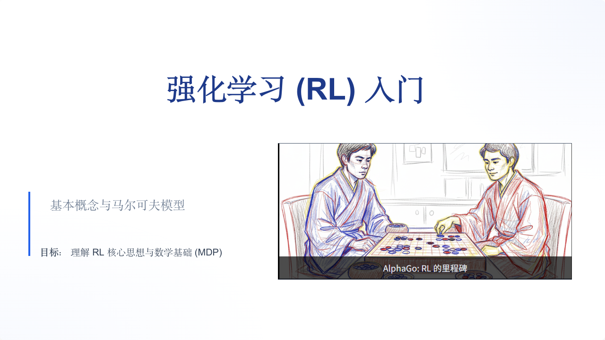

**学习重点**：基本概念与马尔可夫模型。

**课程资料**

- PPT：<a href="../ppt/01-强化学习入门-基本概念与马尔可夫模型.pptx" download>01-强化学习入门-基本概念与马尔可夫模型.pptx</a>
- B 站视频：[强化学习入门](https://www.bilibili.com/video/BV1WqUqBYEAW/)

### 贝尔曼方程 {#bellman-equation}

**学习重点**：贝尔曼方程。

**课程资料**

- PPT：<a href="../ppt/02-Bellman-Equation.pptx" download>02-Bellman-Equation.pptx</a>
- B 站视频：[贝尔曼方程](https://www.bilibili.com/video/BV1XQm4BEEdn/)

### 强化学习核心求解方法 {#rl-methods}

**学习重点**：策略迭代、值迭代、蒙特卡洛方法。

**课程资料**

- PPT：<a href="../ppt/03-强化学习核心求解方法.pptx" download>03-强化学习核心求解方法.pptx</a>

### 时序差分算法入门 {#td-intro}

**学习重点**：时序差分算法。

**课程资料**

- PPT：<a href="../ppt/04-时序差分算法.pptx" download>04-时序差分算法.pptx</a>

> PDF 中没有对应时序差分模块的配图；原稿未为这四个基础模块单独列出作业或交付要求，也未为后两个模块提供视频地址。

## MotrixLab 入门精品课程

### 第 1 讲：课程导论：MotrixLab 能做什么 {#lesson-1}

**学习重点**

- MotrixLab 的定位与应用场景
- 机器人强化学习平台的核心价值
- 课程学习路径与目标

**课程资料**

- 课程教案：[MotrixLab入门课程（1）—— 课程导论：MotrixLab 能做什么](https://ucnj8k63v5wn.feishu.cn/docx/SpkXdeFWAoGgj0xGLU1c6cQxngf)
- 课程 PPT：<a href="../ppt/05-MotrixLab-框架介绍.pptx" download>05-MotrixLab-框架介绍.pptx</a>
- 学习视频文件名：`第1讲.mp4`（原稿未提供在线地址）

**课程作业**

1. 结合课程内容，用自己的话解释 MotrixLab 的定位：它是一个什么样的平台？主要解决什么问题？
2. 说说机器人强化学习平台相比于从零写训练代码有哪些核心价值（至少列出 3 点）。
3. 看完课程学习路径图后，简要规划一下自己的学习目标和预期产出。

**交付要求**：形成一份学习文档，包含上述问题的回答和本节课程总结。

---

### 第 2 讲：基础框架总览：分层架构怎么看 {#lesson-2}

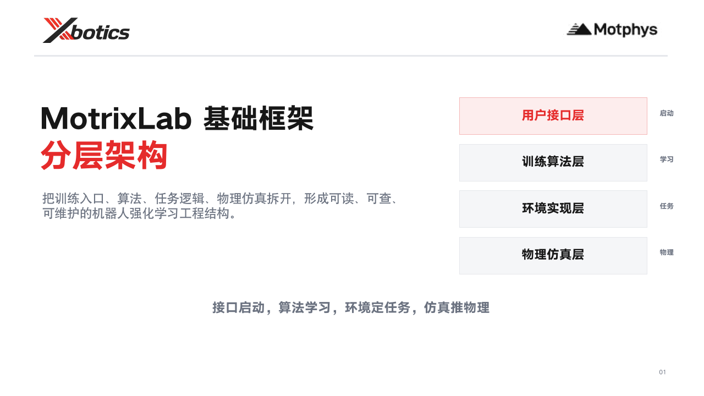

**学习重点**

- MotrixLab 的整体分层设计
- 用户接口层、训练算法层、环境实现层、物理仿真层
- 各层之间的关系与职责划分

**课程资料**

- 课程教案：[MotrixLab入门课程（2）—— 基础框架总览：分层架构怎么看](https://tcnmf6tdu5z9.feishu.cn/wiki/TFuMwcII0i1UT1kCqOWcleeVn4c?from=from_copylink)
- 课程 PPT：<a href="../ppt/06-MotrixLab-分层结构.pptx" download>06-MotrixLab-分层结构.pptx</a>
- 学习视频文件名：`第2讲.mp4`（原稿未提供在线地址）

**课程作业**

1. 画出 MotrixLab 的四层分层架构示意图（用户接口层、训练算法层、环境实现层、物理仿真层），并用文字描述每一层的职责。
2. 思考为什么要把架构分成这么多层：直接把环境、算法、仿真写在一起不行吗？说出分层设计的至少 2 个好处。
3. 选一个熟悉的机器人任务（如倒立摆、机械臂抓取、四足行走），分析它应该落在架构的哪一层，各层分别如何为其服务。

**交付要求**：形成一份学习文档，包含架构图（可手绘拍照或用工具画）、各层说明、分层好处分析和本节课程总结。

---

### 第 3 讲：训练环境：`EnvCfg`、`Env`、`Reward` 的关系 {#lesson-3}

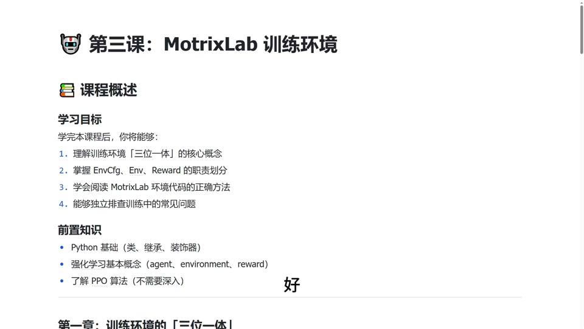

**学习重点**

- 训练环境的组成
- `EnvCfg` 如何定义环境参数
- `Env` 如何实现任务逻辑
- `Reward` 如何驱动学习

**课程资料**

- 课程教案：[MotrixLab入门课程（3）—— 训练环境：EnvCfg、Env、Reward 的关系](https://ucnj8k63v5wn.feishu.cn/docx/EqkzdvVXloTM99x2g7GcntBMnBe)
- 学习视频文件名：`第3讲.mp4`（原稿未提供在线地址）

**课程作业**

1. 分别说明 `EnvCfg`、`Env`、`Reward` 三个类在 MotrixLab 中各扮演什么角色，用一句话概括每个类的核心职责。
2. 以 CartPole 为例，尝试写出 `EnvCfg` 中至少需要定义哪些参数（如观测维度、动作维度等）。
3. 思考为什么要把环境配置（`EnvCfg`）和环境实现（`Env`）分开设计，不写在一起有什么好处。

**交付要求**：形成一份学习文档，包含三个类的角色说明、CartPole 配置参数示例、对“分离设计”的理解和本节课程总结。

---

### 第 4 讲：奖励函数：为什么奖励决定训练成败 {#lesson-4}

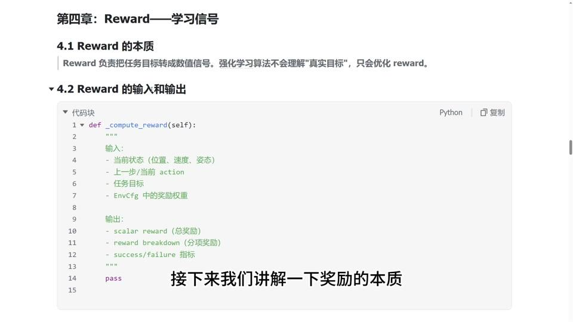

**学习重点**

- 奖励函数在强化学习中的作用
- 奖励设计的基本原则
- 常见奖励结构与设计思路
- 奖励不合理会带来什么问题

**课程资料**

- 课程教案：[MotrixLab入门课程（4）—— 奖励函数：为什么奖励决定训练成败](https://ucnj8k63v5wn.feishu.cn/docx/TRqRdemjtoCEWKxU9gHcC73jndh)
- 学习视频文件名：`第4讲.mp4`（原稿未提供在线地址）

**课程作业**

1. 列举奖励函数的 3 个常见设计原则，并用自己的话解释每条原则为什么重要。
2. 思考“奖励稀疏”和“奖励稠密”的区别。如果倒立摆任务的奖励只是在倒下时给 `-1`、不倒时给 `0`，训练会有什么问题？
3. 为一个简单任务（如让机器人走到目标点）设计奖励函数框架（可用伪代码或文字描述）。

**交付要求**：形成一份学习文档，包含奖励设计原则的说明、稀疏/稠密奖励对比分析、设计的奖励函数框架和本节课程总结。

---

### 第 5 讲：配置系统：环境配置与训练配置怎么协作（30min） {#lesson-5}

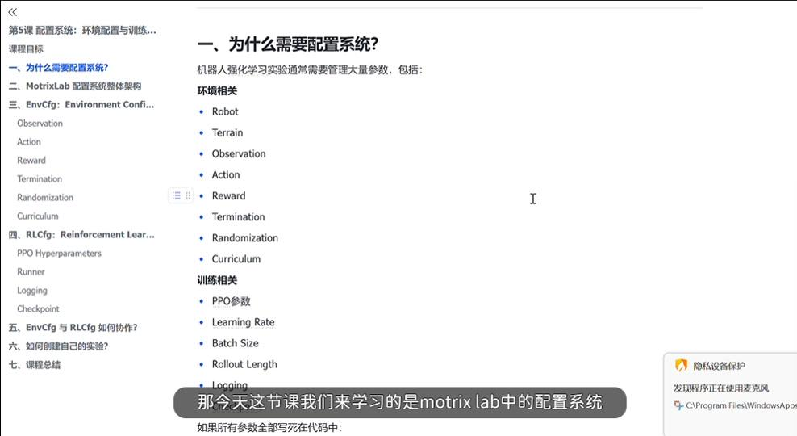

**学习重点**

- `EnvCfg` 与 `RLCfg` 的分工
- 参数继承、覆盖与管理方式
- 如何通过配置灵活控制实验行为

**课程资料**

- 课程教案：[第5课 配置系统：环境配置与训练配置如何协作](https://ucnj8k63v5wn.feishu.cn/docx/KWb4dycPQo5eoZxkgVrcFdutn1c)
- 学习视频文件名：`Lesson5.mp4`（原稿未提供在线地址）

**课程作业**

结合本节课阅读一个机器人任务对应的 `Environment` 和 `EnvCfg` 源码，回答：

1. `Environment` 在整个强化学习训练流程中的职责是什么？
2. `EnvCfg` 为什么需要独立于 `Environment` 存在？
3. 任选一个机器人任务，画出该任务 `Environment` 与 `EnvCfg` 的关系图，至少包括 `Environment`、`EnvCfg`、`Observation`、`Reward`、`Reset`、`Step`，并说明各部分之间的数据流。

**交付要求**：形成一份学习文档，包含上述问题的回答和本节课程总结。

---

### 第 6 讲：注册系统：新环境如何接入框架 {#lesson-6}

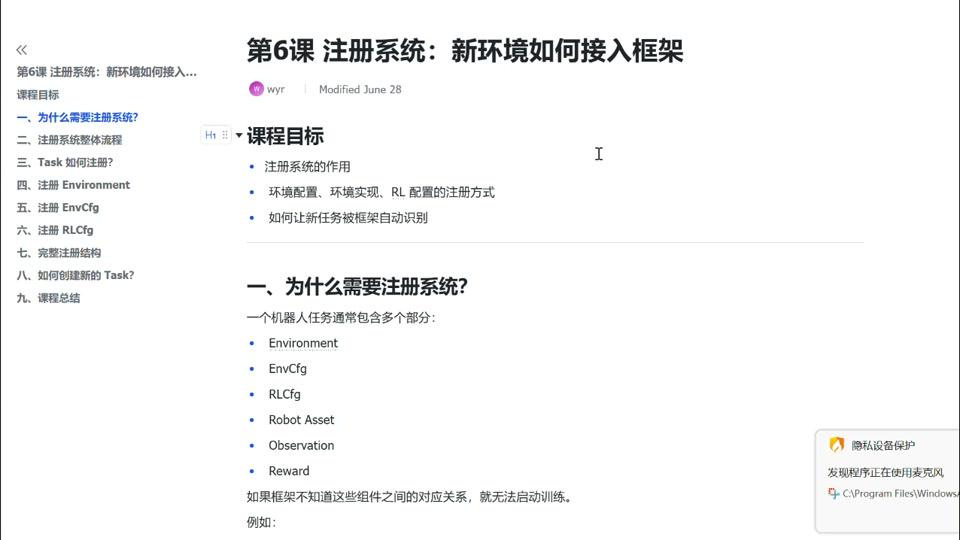

**学习重点**

- 注册系统的作用
- 环境配置、环境实现、RL 配置的注册方式
- 如何让新任务被框架自动识别

**课程资料**

- 课程教案：[第6课 注册系统：新环境如何接入框架](https://my.feishu.cn/docx/FcEhd1q5KoYouwxJW9YcQS3Fn9d)
- 学习视频文件名：`Lesson6.mp4`（原稿未提供在线地址）

**课程作业**

1. 结合源码说明 Registry 在整个 MotrixLab 中承担什么职责：Registry 保存了哪些信息？为什么不直接创建 `Environment`？
2. 结合源码说明一个新的 `Environment` 如何完成注册：Python 导入模块时发生了什么？装饰器在什么时候执行？Registry 在什么时候保存 `Environment` 与 `EnvCfg`？

**交付要求**：形成一份学习文档，包含上述问题的回答和本节课程总结。

---

### 第 7 讲：训练流程：从 `train.py` 到模型保存 {#lesson-7}

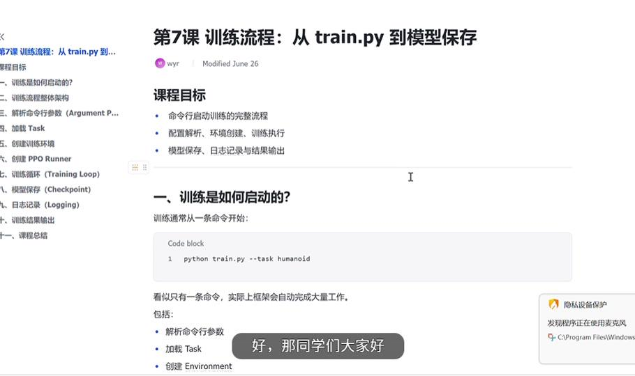

**学习重点**

- 命令行启动训练的完整流程
- 配置解析、环境创建、训练执行
- 模型保存、日志记录与结果输出

**课程资料**

- 课程教案：[第7课 训练流程：从 train.py 到模型保存](https://my.feishu.cn/docx/TE06dQwwOoFvC8xly7kcMxs5nUf)
- 学习视频文件名：`Lesson7.mp4`（原稿未提供在线地址）

**课程作业**

1. 结合源码说明，从执行 `python scripts/train.py` 开始，到训练正式启动之前，程序主要经历哪些步骤？按实际执行顺序描述整个 Workflow。
2. 说明训练过程中 `Environment`、`EnvCfg` 和 `RLCfg` 分别在哪个阶段参与工作：三者分别在哪里创建、负责哪些内容、最终在哪里汇合形成完整训练流程？
3. 用简要文字说明 `train.py`、`Trainer`、`Registry`、`make()`、`Environment`、`EnvCfg`、`PPO Config`、`Agent`、`SequentialTrainer`、`Train` 之间的数据流和调用关系。

**交付要求**：形成一份学习文档，并绘制训练流程图。

---

### 第 8 讲：Demo 分析方法：如何读懂一个案例 {#lesson-8}

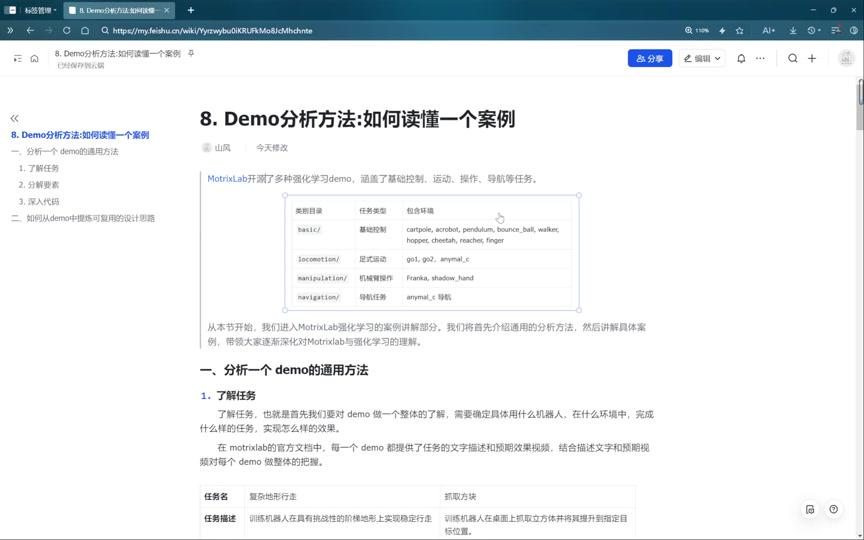

**学习重点**

- 分析一个 Demo 的通用方法
- 任务目标、观测、动作、奖励、终止条件
- 如何从案例中提炼可复用的设计思路

**课程资料**

- 课程教案：[Demo分析方法：如何读懂一个案例](https://ucnj8k63v5wn.feishu.cn/docx/CmpSdCycbo4Sl4x19Yfcadxdnnh)
- 学习视频文件名：`8. demo分析方法.mp4`（原稿未提供在线地址）
- 参考文档：[MotrixLab 官方 CartPole Demo](https://motrixlab.readthedocs.io/zh-cn/latest/user_guide/demo/cartpole.html)

**课程作业**

1. 整理本节课的学习内容，重点理解强化学习的通用流程和 8 个要素，研究 MotrixLab 的对应实现方法。
2. 结合 MotrixLab 官方文档，独立完成倒立摆 CartPole 任务环境的 8 个强化学习要素分析和对应的 MotrixLab 实现代码分析；可以在后续课程中验证。

**交付要求**：整理一份学习体会以及 CartPole 任务的要素分析和代码分析文档，清楚描述各部分内容。

---

### 第 9 讲：基础控制 Demo：倒立摆 / 单摆 / 双连杆 {#lesson-9}

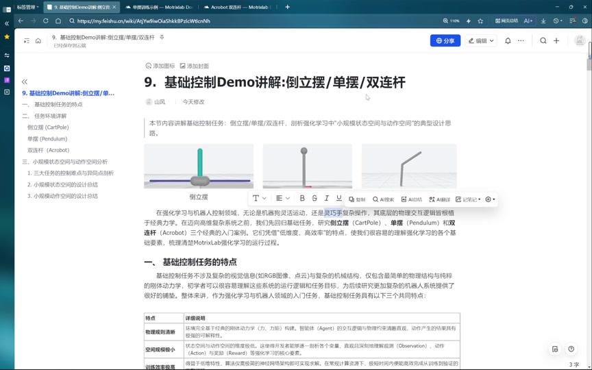

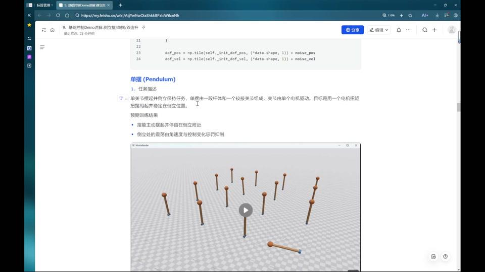

**学习重点**

- 经典控制任务的特点
- 小规模状态空间与动作空间分析
- 基础强化学习训练流程示例

**课程资料**

- 课程教案：[基础控制Demo讲解：倒立摆 / 单摆 / 双连杆](https://ucnj8k63v5wn.feishu.cn/docx/NYOAdtmHFo8e3txNi7IcnBHJnwe)
- 学习视频文件名：`9.1. 基础控制 Demo 讲解.mp4`、`9.2. 基础控制 Demo 讲解.mp4`（原稿未提供在线地址）
- 参考文档：[双关节机械臂控制任务](https://motrixlab.readthedocs.io/zh-cn/latest/user_guide/demo/dm_reacher.html)

**课程作业**

1. 跑通三个基础控制 Demo，比较三个任务的强化学习 8 个要素的相同点和不同点，并形成文档。
2. 结合课程内容，修改 MotrixLab 源代码中单摆任务奖励函数的能量部分，对比修改前后单摆最后竖直的效果。
3. 自行探索 MotrixLab 中的双关节机械臂控制任务，整理其强化学习 8 个要素并形成文档。

**交付要求**

- 跑通 MotrixLab 开源的三个经典任务的视频。
- 单摆奖励函数修改前后的对比视频。
- 三个 Demo 对比文档和双关节机械臂控制任务的强化学习要素研究文档。

---

### 第 10 讲：机械臂与抓取 Demo {#lesson-10}

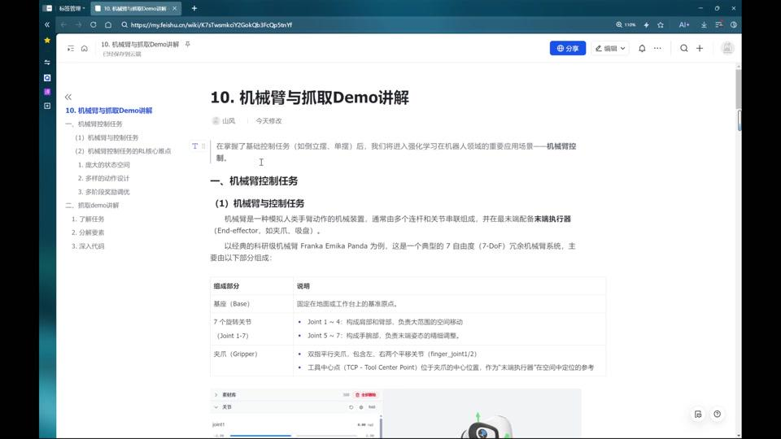

**学习重点**

- 机械臂控制任务的核心难点
- 抓取、到达、操作类任务的奖励设计
- 接触控制与精细动作学习

**课程资料**

- 课程教案：[机械臂与抓取Demo讲解](https://ucnj8k63v5wn.feishu.cn/docx/WjEtdSC9mo0DOYxxXtVcUugqnFg)
- 学习视频文件名：`10. 机械臂与抓取 Demo 讲解.mp4`（原稿未提供在线地址）

**课程作业**

1. 结合课程内容，修改 MotrixLab 源代码中 `franka lift cube` 任务的奖励函数，并尝试增大训练步数，实现更优的抓取效果。
2. 自行研究 Franka 打开抽屉任务，整理强化学习 8 个要素并与 `franka-lift-cube` 对比，分析异同点，形成分析文档。

**交付要求**

- `franka-lift-cube` 任务奖励函数修改前后的对比视频。
- `franka-lift-cube` 和打开抽屉任务的强化学习要素对比文档。

---

### 第 11 讲：运动机器人 Demo：Walker / GO1 / Humanoid {#lesson-11}

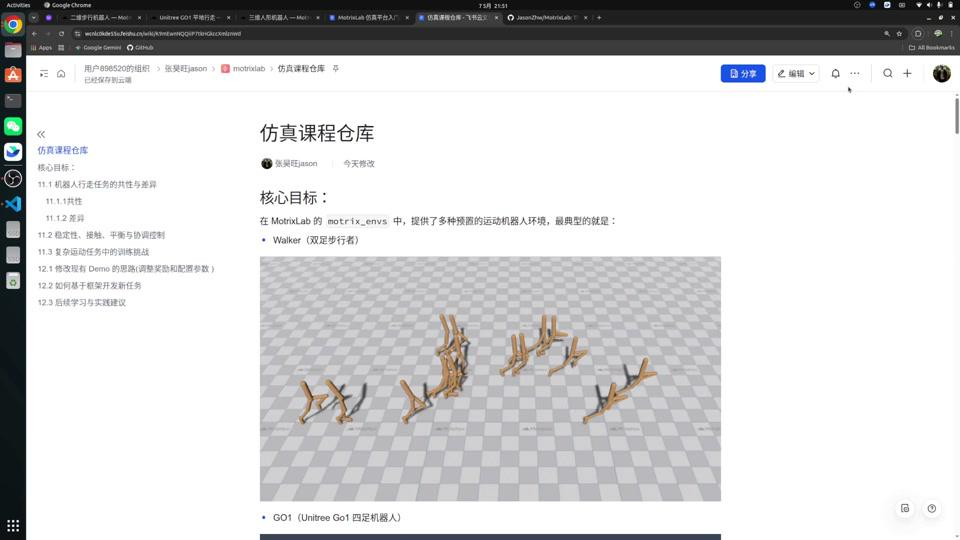

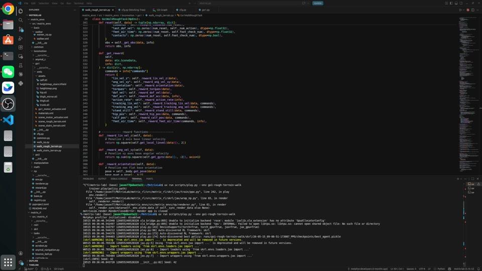

**学习重点**

- 机器人行走任务的共性与差异
- 稳定性、接触、平衡与协调控制
- 复杂运动任务中的训练挑战

**课程资料**

- 课程教案：[运动机器人 Demo 讲解：Walker / GO1 / Humanoid](https://ucnj8k63v5wn.feishu.cn/docx/IwqZdUycAoC55AxkzPzcSiIpnzd)
- 学习视频文件名：`part11上.mp4`、`part11下.mp4`（原稿未提供在线地址）

**课程作业**：根据课程教案和学习视频，理解不同奖励设计对策略的影响，理解不同机器人构型造成的训练难度差异，建立奖励函数到训练后动作的大致映射感觉。

**交付要求**：三个任务的 baseline 跑通视频，以及观测空间、奖励函数、训练超参数的理解文档。

---

### 第 12 讲：总结：如何自己改 Demo、调奖励、做新任务 {#lesson-12}

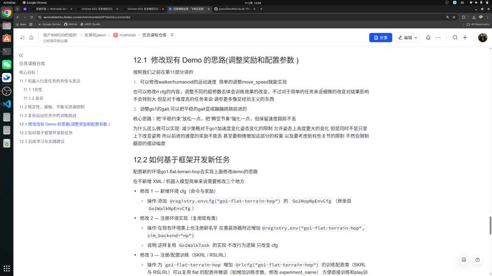

**学习重点**

- 修改现有 Demo 的思路
- 如何调整奖励和配置参数
- 如何基于框架开发新任务
- 后续学习与实践建议

**课程资料**

- 课程教案：[总结：如何自己改 Demo、调奖励、做新任务](https://ucnj8k63v5wn.feishu.cn/docx/QPshdrVOCocs9px9n6dcRB2OnZf)
- 学习视频文件名：`part12.mp4`（原稿未提供在线地址）

**课程作业**：训练一个新的 GO1 步态，跑通修改 Demo 的全流程。

**交付要求**：输出训练新步态的视频，以及奖励函数修改的记录文档。
